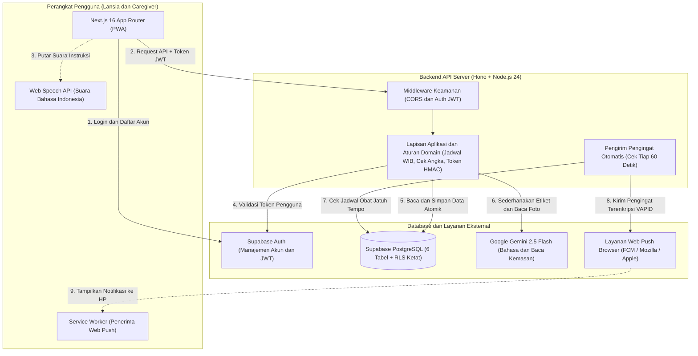
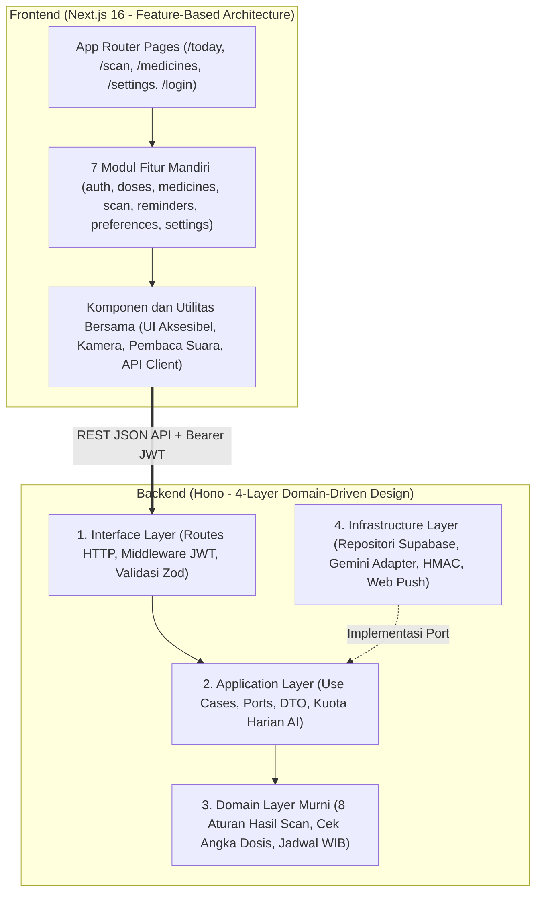
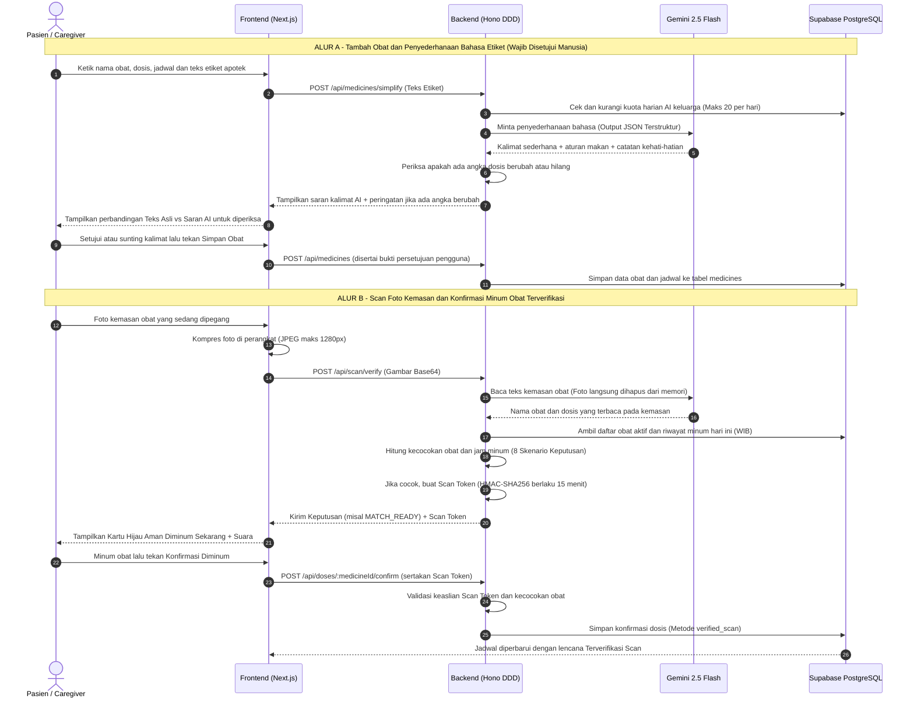

# 💊 MOSA — Medication Organizer, Scanner & Assistant

> **Asisten Jadwal & Verifikasi Minum Obat Keluarga yang Aman, Ramah Lansia, dan Mudah Dipahami**
> Disusun untuk **LOGICODIX Hackathon Competition 2026**
> **Kategori:** Web Development | **Subtema 4:** *Inclusive Health & Well-being* — *"Code the Care, Build the Future"*

- 🌐 **Live Web App (Production):** [https://mosa-app-black.vercel.app](https://mosa-app-black.vercel.app)
- 🎥 **Video Demo YouTube (3–5 Menit):** [https://youtu.be/oanu9UJwj60](https://youtu.be/oanu9UJwj60)

---

## 1. Informasi Tim

- **Nama Tim:** `TikumGriyashanta`
- **Kategori Lomba:** `Web`
- **Subtema:** Subtema 4 — *Inclusive Health & Well-being*

| Nama Lengkap Anggota | Peran (*Role*) | GitHub |
| :--- | :--- | :--- |
| **Rakha Ahmad Fabiano** | Product Manager (PM) | [@rakhaaf8](https://github.com/rakhaaf8) |
| **Mohammad Rahardian Atsil Qushoyyi** | Product Designer / UI-UX (PD) | [@Rahardian-Atsil](https://github.com/Rahardian-Atsil) |
| **Muhammad Ammar Triwahyu Fakhruddin** | Frontend Engineer (FE) | [@Ammartriwahyu](https://github.com/Ammartriwahyu) |
| **M. Jefry Leonardi** | Backend Engineer (BE) | [@LeonardiJefry](https://github.com/LeonardiJefry) |

---

## 2. Deskripsi Aplikasi, Masalah yang Diangkat & Target Pengguna

### Latar Belakang Masalah
Di banyak keluarga Indonesia, pasien lanjut usia (lansia) dengan kondisi kronis seperti hipertensi, diabetes, atau kolesterol harus mengonsumsi **3 hingga 6 jenis obat setiap hari** pada jam yang berbeda-beda. Kondisi ini sering menimbulkan tiga masalah nyata di rumah:

1. **Kemasan Obat Mirip & Tulisan Terlalu Kecil:** Strip dan botol obat sering kali terlihat serupa, sementara tulisan pada etiket apotek berukuran kecil dan menggunakan istilah medis/singkatan yang membingungkan (seperti *3 dd 1 tab pc*). Akibatnya, pasien rawan **salah ambil obat**, **lupa minum**, atau **minum dosis ganda** karena lupa sudah minum atau belum.
2. **Kekhawatiran Pendamping Keluarga (*Caregiver*):** Anak atau anggota keluarga yang sedang bekerja di luar rumah sering cemas dan berulang kali bertanya lewat chat/telepon: *"Ibu sudah minum obat pagi belum? Tadi yang diminum obat yang mana?"*
3. **Bahaya Halusinasi AI pada Aplikasi Kesehatan:** Banyak aplikasi kesehatan menyerahkan keputusan medis langsung kepada AI (LLM). Padahal, kesalahan AI dalam membaca angka dosis (misalnya membaca `5 mg` menjadi `50 mg`) sangat berbahaya bagi keselamatan pasien.

### Solusi: MOSA (Medication Organizer, Scanner & Assistant)
**MOSA** adalah aplikasi web progresif (*Progressive Web App* / PWA) yang membantu pasien lansia dan pendamping keluarga mengelola jadwal obat harian, menyederhanakan bahasa etiket obat yang rumit menjadi kalimat Bahasa Indonesia sehari-hari, serta **memastikan obat yang dipegang benar-benar sesuai jadwal sebelum diminum** hanya dengan memfoto kemasannya.

MOSA dirancang dengan prinsip utama **Keselamatan Pasien di Atas Segalanya (*Safety-First*)**:
- **AI hanya bertugas menyederhanaan bahasa dan membaca teks kemasan**, bukan menjadi pengambil keputusan medis.
- Setiap hasil bacaan AI **wajib diperiksa dan disetujui manusia** sebelum disimpan, disertai peringatan otomatis bila ada angka dosis yang berubah.
- Penentuan apakah suatu obat **aman diminum sekarang, belum waktunya, sudah diminum, atau salah obat** dihitung 100% secara pasti oleh aturan sistem di server (*deterministic rules*), bukan ditebak oleh AI.

### Target Pengguna
1. **Pasien Lansia & Pasien Rawat Jalan di Rumah:** Membutuhkan tampilan aplikasi yang bersih, huruf besar, kontras tinggi, tombol berukuran besar, serta fitur pembaca suara Bahasa Indonesia agar instruksi obat dapat didengarkan dengan jelas tanpa harus menyipitkan mata.
2. **Pendamping Keluarga (*Caregiver* / Anak / Pasangan):** Mengatur daftar obat orang tua, memantau status kepatuhan minum obat dari jarak jauh, serta memastikan obat yang diminum di rumah sudah terverifikasi lewat foto kemasan.

---

## 3. Fitur Utama yang Berhasil Diimplementasikan

### 1. 📷 Scan Kemasan Obat & 8 Skenario Keputusan Otomatis + Bukti Minum Dua Tingkat (`✓✓` vs `✓`)
- **Cek Obat Sebelum Diminum:** Pengguna cukup memfoto kemasan atau etiket obat yang sedang dipegang. Sistem akan mengekstrak nama obat pada foto, mencocokkannya dengan daftar obat di akun keluarga, dan mengecek jadwal hari ini.
- **8 Hasil Keputusan yang Jelas & Pasti:** Sistem memberikan kartu hasil berwarna kontras dengan penjelasan yang mudah dimengerti untuk **8 kondisi berbeda**:
  1. `MATCH_READY` (Hijau): **Aman Diminum Sekarang** — obat cocok dan berada dalam rentang waktu minum (±60 menit dari jadwal).
  2. `MATCH_EARLY` (Kuning): **Belum Waktunya Diminum** — obat cocok, tetapi jadwalnya masih lebih dari 60 menit lagi (menampilkan hitung mundur waktu tunggu).
  3. `MATCH_LATE` (Oranye): **Jadwal Terlewat** — obat cocok, tetapi jam minumnya sudah lewat lebih dari 60 menit (dilengkapi peringatan hati-hati agar tidak bertabrakan dengan dosis berikutnya).
  4. `ALREADY_TAKEN` (Biru): **Sudah Diminum** — mencegah overdosis/dosis ganda karena mencatat jam konfirmasi sebelumnya.
  5. `WRONG_MEDICINE` (Merah): **Bukan Obat di Daftar Keluarga** — obat tidak terdaftar di akun keluarga dan menyebutkan obat apa yang seharusnya diminum saat ini.
  6. `NO_SCHEDULE_TODAY` (Abu-abu): **Tidak Dijadwalkan Hari Ini** — obat terdaftar, tetapi bukan untuk hari ini.
  7. `AMBIGUOUS` (Ungu): **Cocok dengan Beberapa Obat** — meminta pengguna memilih obat yang tepat secara manual.
  8. `UNREADABLE` (Abu-abu): **Foto Kurang Jelas** — mengarahkan pengguna memfoto ulang di tempat terang atau konfirmasi manual.
- **Tanda Bukti Minum Dua Tingkat (`✓✓` vs `✓`):**
  - Jika pengguna menekan **"Konfirmasi Diminum"** setelah memfoto kemasan obat yang cocok, server memberikan token keamanan khusus sehingga jadwal tercatat dengan tanda **`✓✓ Terverifikasi Scan`** (bukti kuat bagi keluarga bahwa obat yang dipegang memang benar).
  - Jika pengguna mengonfirmasi langsung dari beranda tanpa foto, jadwal tercatat dengan tanda **`✓ Konfirmasi Manual`**.
  - Status konfirmasi juga dapat **dibatalkan (*Undo*)** jika tidak sengaja tertekan.

### 2. ✨ Penyederhanaan Bahasa Etiket Obat dengan AI & Pemeriksaan Manusia Wajib
- **Bahasa Medis Jadi Bahasa Sehari-hari:** Mengubah instruksi etiket yang kaku (mis. *"Amlodipine 10mg 1x1 malam sesudah makan"*) menjadi kalimat Bahasa Indonesia yang ramah dan mudah dipahami lansia, lengkap dengan tujuan obat, aturan makan, dan catatan kehati-hatian umum.
- **Layar Pemeriksaan Wajib (*Mandatory Review Gate*):** Hasil dari AI tidak pernah langsung tersimpan. Aplikasi menampilkan perbandingan berdampingan antara **teks asli pengguna** dan **saran kalimat dari AI** agar diperiksa terlebih dahulu.
- **Pendeteksi Perubahan Angka Dosis Otomatis:** Jika sistem mendeteksi ada angka (seperti `10 mg`, `500 mg`, atau `3x1`) pada teks asli yang hilang atau berubah di teks AI, muncul kotak peringatan kuning yang menyorot angka tersebut dan mewajibkan pengguna mencentang persetujuan manual sebelum obat bisa disimpan.
- **Tetap Berfungsi Tanpa AI:** Jika kuota AI habis atau koneksi ke layanan AI sedang gangguan, pengguna tetap dapat menyimpan dan mengelola obat secara manual tanpa hambatan.

### 3. 🗓️ Dasbor Jadwal Harian WIB & Pemantauan Bersama Keluarga
- **Jadwal Otomatis per Waktu Minum:** Mengelompokkan obat harian ke dalam bagian **Pagi**, **Siang**, **Sore**, dan **Malam** sesuai zona waktu **WIB (`Asia/Jakarta`)**, dilengkapi ringkasan progres harian (mis. *"3 dari 5 dosis selesai hari ini"*).
- **Status Waktu Nyata:** Setiap kartu jadwal menampilkan status yang jelas: *Belum Waktunya*, *Waktunya Minum*, *Terlewat*, atau *Sudah Diminum*, serta otomatis menyegarkan tampilan saat pergantian hari.
- **Filter Per Anggota Keluarga:** Jika dalam satu rumah ada lebih dari satu orang yang rutin minum obat (mis. Bapak dan Ibu), jadwal di beranda dapat difilter per anggota keluarga agar tidak tertukar.

### 4. 🔊 Pembaca Suara Bahasa Indonesia Lokal (*Text-to-Speech*) & Tampilan Ramah Lansia
- **Dengarkan Instruksi Obat:** Setiap kartu jadwal di beranda, hasil scan kemasan, dan detail obat memiliki tombol **"Dengarkan"** yang membacakan nama obat, dosis, jam minum, dan petunjuk penggunaannya dalam Bahasa Indonesia (`id-ID`).
- **Privasi Suara Terjaga di Perangkat:** Fitur suara memprioritaskan mesin pembaca suara bawaan perangkat (*on-device speech*) sehingga teks nama obat pengguna tidak dikirim ke layanan suara pihak ketiga di internet.
- **Mode Ukuran Huruf Besar (*Large Text Mode*):** Tersedia pilihan ukuran teks **Standar** dan **Besar (Lansia)** yang memperbesar seluruh huruf secara proporsional. Seluruh tombol utama dirancang berukuran minimal **56×56 px** dengan jarak aman agar mudah ditekan oleh jari lansia yang gemetar (*tremor*).

### 5. 🔔 Aplikasi PWA (*Installable*) & Pengingat Notifikasi Terjadwal
- **Dapat Diinstal ke Layar Utama HP:** Dilengkapi konfigurasi *Progressive Web App* (`manifest.webmanifest` dan Service Worker) sehingga dapat dipasang ke layar utama (*Add to Home Screen*) layaknya aplikasi native di Android maupun iOS.
- **Notifikasi Tepat Waktu Walau Browser Ditutup:** Pengingat Web Push dikirim oleh server tepat pada jam minum obat menggunakan enkripsi VAPID. Sistem antrean di database memastikan satu jadwal hanya mengirim satu notifikasi (tidak spam/duplikat), dan saat notifikasi diketuk, pengguna langsung diarahkan ke obat yang harus diminum.

### 6. 👨‍👩‍👧 Akun Keluarga Bersama & Kendali Privasi Data Penuh
- **Satu Akun untuk Satu Keluarga:** Saat mendaftar, pengguna otomatis mendapatkan ruang keluarga (*Household*) untuk mengelola jadwal obat seluruh anggota keluarga di rumah.
- **Kendali Privasi & Penghapusan Data Permanen:** Halaman Pengaturan menyediakan lembar persetujuan privasi (*Privacy Notice*) yang transparan mengenai data apa yang diproses, serta fitur **Hapus Akun & Seluruh Data Keluarga** yang menghapus seluruh data obat, riwayat minum, dan akun secara permanen.

---

## 4. Teknologi yang Digunakan (*Tech Stack*)

Proyek ini dibangun menggunakan arsitektur **Monorepo (`pnpm workspaces`)** yang memisahkan `frontend` dan `backend` secara rapi dengan dukungan **TypeScript (`strict mode`)** di kedua sisi.

### Frontend (`frontend/`)
- **Framework:** Next.js `16.4.6` (App Router) & React `19.3.0`
- **Bahasa:** TypeScript `5.9.3`
- **Styling & Komponen UI:** Tailwind CSS `4.3.3`, Radix UI (`@radix-ui/react-dialog`, `@radix-ui/react-slot`), Lucide React `1.71.0`, dan font `@fontsource-variable/plus-jakarta-sans`
- **Manajemen State & Data Fetching:** TanStack React Query `5.107.1`
- **Validasi Skema:** Zod `4.6.7`
- **Autentikasi Klien:** `@supabase/supabase-js` `2.119.0` (khusus sesi login/register)
- **Kemampuan Web & Aksesibilitas:** Web Speech API (`speechSynthesis` Bahasa Indonesia), Web Push API & Service Worker (`sw.js`), serta `MediaDevices` / HTML5 Camera Capture

### Backend (`backend/`)
- **Framework & Runtime:** Hono `4.13.17` di atas `@hono/node-server` `2.1.6` (Node.js `24.x`)
- **Arsitektur Kode:** *Domain-Driven Design* (DDD) 4 Lapisan (`interface`, `application`, `domain`, `infrastructure`) yang dibagi ke dalam 5 modul utama (*Bounded Contexts*): `household`, `medication`, `dosing`, `verification`, dan `notification`
- **Validasi & Keamanan:** Zod `4.6.7`, pembuatan & pemeriksaan token scan `HMAC-SHA256` (`node:crypto` dengan `timingSafeEqual` anti-*timing attack*)
- **AI SDK:** `@google/genai` `2.32.0` (Google Gemini API dengan *Structured JSON Output* dan *AbortSignal Timeout*)
- **Notifikasi Push:** `web-push` `4.0.0` (Protokol Web Push RFC 8030 & autentikasi VAPID RFC 8292)

### Database & Layanan Pihak Ketiga
- **Database & Autentikasi:** **Supabase** (PostgreSQL + Supabase Auth JWT)
- **Keamanan Database (*Zero Direct Public Access*):** Seluruh 6 tabel utama mengaktifkan *Row-Level Security* (RLS) dan mencabut akses langsung dari publik (`REVOKE ALL ON ALL TABLES IN SCHEMA public FROM anon, authenticated`). Semua transaksi data wajib melewati validasi di server Backend Hono.
- **Layanan AI:** **Google Gemini API** (`gemini-2.5-flash` dengan cadangan otomatis ke `gemini-2.5-flash-lite`)
- **Pengujian & Kualitas Kode:** Vitest `5.1.0`, Testing Library, `@electric-sql/pglite` `0.5.16` (pengujian SQL PostgreSQL asli di memori), `axe-core` `4.14.0` (audit aksesibilitas otomatis), dan `eslint-plugin-boundaries` `7.4.2` (**1.332 pengujian otomatis lulus**: 743 tes backend + 589 tes frontend).

---

## 5. Diagram Arsitektur Sistem & Alur Data

Untuk memudahkan pemahaman terhadap cara kerja **MOSA**, arsitektur sistem dibagi menjadi tiga tampilan: **(1) Arsitektur Konteks Sistem**, **(2) Struktur Internal Monorepo**, dan **(3) Alur Data Verifikasi Kemasan Obat & Konfirmasi Dosis**.

### 5.1. Diagram Konteks & Topologi Sistem (*System Context Architecture*)
Menunjukkan hubungan antara perangkat pengguna, aplikasi web Next.js, server API Hono, database PostgreSQL Supabase, dan layanan Google Gemini API:



---

### 5.2. Struktur Modul Internal (*Feature-Based Frontend & DDD Backend*)
Kode program diorganisasikan agar batas tanggung jawab antar fitur dan aturan keselamatan domain tetap rapi serta mudah diuji:



| Modul Backend (*Bounded Context*) | Tanggung Jawab Utama | Tabel Database Terkait |
| :--- | :--- | :--- |
| **`household`** | Pembuatan ruang keluarga otomatis saat registrasi dan penghapusan akun beserta seluruh data secara permanen. | `households` |
| **`medication`** | Pengelolaan daftar obat, jadwal minum harian, penyederhanaan teks etiket berbantuan AI, dan deteksi perubahan angka dosis. | `medicines`, `ai_usage` |
| **`dosing`** | Perhitungan jadwal dosis harian sesuai zona waktu WIB (`Asia/Jakarta`), status waktu minum, dan pencatatan konfirmasi minum obat. | `dose_confirmations` |
| **`verification`** | Pembacaan foto kemasan obat, pencocokan nama obat (*fuzzy matching*), penentuan **8 skenario hasil scan**, dan pembuatan token keamanan `HMAC-SHA256`. | `medicines`, `dose_confirmations` |
| **`notification`** | Pendaftaran langganan Web Push perangkat dan pengiriman pengingat terjadwal setiap menit tanpa duplikasi. | `push_subscriptions`, `reminder_dispatches` |

---

### 5.3. Diagram Alur Data Utama (*End-to-End Safe Medication Flow*)
Menjelaskan bagaimana perlindungan keselamatan bekerja pada dua alur terpenting: **(A) Menambah Obat dengan Pemeriksaan Manusia**, dan **(B) Memfoto Kemasan Obat hingga Tercatat `✓✓ Terverifikasi Scan`**:


## 6. Akun Demonstrasi & Akses Pengujian Juri

Aplikasi ini menggunakan sistem autentikasi pengguna. Agar Dewan Juri dapat langsung menguji seluruh fitur (Jadwal Harian, Scan Kemasan Obat, Penyederhanaan Bahasa AI, Pembaca Suara Bahasa Indonesia, dan Pengaturan), kami telah menyiapkan **Akun Demo** yang sudah terisi dengan skenario obat keluarga:

- **URL Aplikasi Live:** [https://mosa-app-black.vercel.app/login](https://mosa-app-black.vercel.app/login)
- **Email Demo:** `demo@mosa.com`
- **Kata Sandi (*Password*):** `mosakeren`

> **Catatan untuk Dewan Juri:**
> - Anda dapat masuk langsung menggunakan **Email & Kata Sandi Demo** di atas pada halaman `/login`, **atau** mendaftarkan akun baru sendiri melalui halaman `/register` (konfirmasi email telah dinonaktifkan agar akun baru dapat langsung masuk tanpa menunggu email verifikasi).
> - Jika menguji secara lokal (*localhost*), jalankan perintah `pnpm --filter backend seed:demo` untuk mengisi ulang data contoh pada akun demo kapan saja.

---

## 7. Panduan Instalasi, Konfigurasi & Menjalankan Aplikasi (*Localhost*)

### 7.1. Prasyarat Sistem
- **Node.js** versi `24.x` (atau minimal `>= 20.x`)
- **pnpm** versi `12.x` (sudah dipin pada `packageManager: pnpm@12.16.1`)
- Proyek **Supabase** (Cloud atau Supabase CLI lokal)
- Kunci API **Google Gemini** (`GEMINI_API_KEY` dari Google AI Studio — *opsional*, aplikasi tetap berjalan dengan mode manual jika dikosongkan)

### 7.2. Langkah Instalasi & Konfigurasi Database
1. **Clone repositori dan instal seluruh dependensi:**
   ```bash
   git clone <url-repositori-ini>
   cd TikumGriyashanta
   pnpm install
   ```
2. **Salin berkas variabel lingkungan (`.env`):**
   ```bash
   cp backend/.env.example backend/.env
   cp frontend/.env.example frontend/.env.local
   ```
3. **Jalankan migrasi SQL pada Supabase:**
   Jalankan ke-6 berkas migrasi SQL di folder `backend/supabase/migrations/` secara berurutan pada **Supabase SQL Editor** (atau melalui `supabase db reset` jika memakai Supabase CLI lokal):
   - `20261110120000_initial_schema.sql`
   - `20261110130000_add_medicine_purpose.sql`
   - `20261111120000_consume_ai_usage.sql`
   - `20261111180000_dose_confirmation_atomic.sql`
   - `20261112040000_scan_confirmation_identity.sql`
   - `20261113120000_push_reminder_claims.sql`
4. **Buat pasangan kunci VAPID untuk fitur Web Push Notification:**
   ```bash
   pnpm --filter backend push:generate-vapid-keys
   ```
   Salin nilai `VAPID_PUBLIC_KEY`, `VAPID_PRIVATE_KEY`, dan `VAPID_SUBJECT` ke `backend/.env`, serta salin nilai `VAPID_PUBLIC_KEY` ke `NEXT_PUBLIC_VAPID_PUBLIC_KEY` di `frontend/.env.local`.
5. **(Opsional) Isi data awal Akun Demo Juri:**
   ```bash
   pnpm --filter backend seed:demo
   ```

### 7.3. Daftar Variabel Lingkungan (`.env.example`)

#### A. Backend (`backend/.env`)
| Nama Variabel | Wajib? | Deskripsi |
| :--- | :---: | :--- |
| `PORT` | Opsional | Port server HTTP Hono (default: `3001`). |
| `NODE_ENV` | Opsional | Mode lingkungan (`development` / `test` / `production`). |
| `CORS_ORIGIN` | Opsional | Daftar origin frontend yang diizinkan, pisahkan dengan koma (default: `http://localhost:3000`). |
| `SUPABASE_URL` | **Wajib** | URL proyek Supabase (`https://<project-ref>.supabase.co`). |
| `SUPABASE_SECRET_KEY` | **Wajib** | Kunci rahasia server Supabase (`sb_secret_...` atau `service_role` key). |
| `SCAN_TOKEN_SECRET` | **Wajib** (Prod) | Kunci rahasia minimal 32 karakter acak untuk menandatangani token verifikasi scan `HMAC-SHA256`. |
| `GEMINI_API_KEY` | Opsional | API Key Google Gemini untuk fitur penyederhanaan etiket & pembacaan foto kemasan. |
| `GEMINI_MODEL` | Opsional | Model utama Gemini (default: `gemini-2.5-flash`). |
| `GEMINI_FALLBACK_MODEL` | Opsional | Model cadangan otomatis (default: `gemini-2.5-flash-lite`). |
| `VAPID_PUBLIC_KEY` | Opsional* | Kunci publik VAPID untuk Web Push (*wajib jika fitur pengingat push diaktifkan). |
| `VAPID_PRIVATE_KEY` | Opsional* | Kunci privat VAPID untuk Web Push (*wajib jika fitur pengingat push diaktifkan). |
| `VAPID_SUBJECT` | Opsional* | Identitas pengirim VAPID berupa `mailto:...` atau URL `https://...`. |
| `DEMO_USER_ID` | Opsional | UUID tetap untuk akun demo saat menjalankan `seed:demo`. |
| `DEMO_EMAIL` | Opsional | Email akun demo (`demo@mosa.com`). |
| `DEMO_PASSWORD` | Opsional | Kata sandi akun demo (`mosakeren`). |
| `DEMO_PROTECTED` | Opsional | Jika `true`, akun demo dilindungi agar tidak bisa dihapus oleh pengunjung publik. |

#### B. Frontend (`frontend/.env.local`)
| Nama Variabel | Wajib? | Deskripsi |
| :--- | :---: | :--- |
| `NEXT_PUBLIC_API_URL` | **Wajib** | URL server backend Hono (contoh lokal: `http://localhost:3001`). |
| `NEXT_PUBLIC_SUPABASE_URL` | **Wajib** | URL proyek Supabase (sama dengan `SUPABASE_URL` di backend). |
| `NEXT_PUBLIC_SUPABASE_PUBLISHABLE_KEY` | **Wajib** | Kunci publik Supabase (`sb_publishable_...` atau `anon` public key). |
| `NEXT_PUBLIC_VAPID_PUBLIC_KEY` | Opsional | Kunci publik VAPID (harus sama persis dengan `VAPID_PUBLIC_KEY` di backend). |
| `NEXT_PUBLIC_DEMO_EMAIL` | Opsional | Email akun demo untuk pengisian cepat di layar login. |
| `NEXT_PUBLIC_DEMO_PASSWORD` | Opsional | Kata sandi akun demo untuk pengisian cepat di layar login. |

### 7.4. Menjalankan Aplikasi & Verifikasi Kualitas
Jalankan backend dan frontend pada dua terminal terpisah:

```bash
# Terminal 1 — Menjalankan Backend Hono di http://localhost:3001
pnpm --filter backend dev

# Terminal 2 — Menjalankan Frontend Next.js di http://localhost:3000
pnpm --filter frontend dev
```

Untuk menjalankan pemeriksaan tipe, *linter*, batas arsitektur, dan seluruh pengujian otomatis:
```bash
pnpm typecheck          # Pemeriksaan tipe TypeScript di backend & frontend
pnpm lint               # Pemeriksaan ESLint & aturan batas arsitektur (48 probe)
pnpm --filter backend test   # 743 unit, integration & security tests (Vitest + PGlite)
pnpm --filter frontend test  # 589 component, flow & accessibility tests (Vitest + axe-core)
```

---

## 8. Dokumentasi Penggunaan AI

Sesuai ketentuan **Guidebook LOGICODIX 2026**, berikut adalah dokumentasi transparan mengenai pemanfaatan kecerdasan buatan (AI) di dalam produk **MOSA** maupun selama proses pengembangannya:

### 8.1. Layanan & Model AI di Dalam Produk
- **Penyedia & SDK:** Google Gemini API menggunakan SDK resmi `@google/genai` (`v2.32.0`).
- **Model Utama:** `gemini-2.5-flash` (dipilih karena kecepatan respons rendah dan akurasi pembacaan gambar/teks Bahasa Indonesia yang baik).
- **Model Cadangan (*Automatic Fallback*):** `gemini-2.5-flash-lite` (otomatis digunakan jika model utama mengalami beban tinggi `429` atau `503`).

### 8.2. Bagian Produk yang Memanfaatkan AI
AI di **MOSA** dibatasi secara ketat hanya pada **2 fungsi bantu non-klinis**:
1. **Penyederhanaan Bahasa Etiket Obat (`POST /api/medicines/simplify`):** Mengubah singkatan atau kalimat etiket apotek yang rumit menjadi kalimat Bahasa Indonesia sehari-hari yang mudah dipahami lansia, disertai informasi waktu makan dan catatan kehati-hatian umum.
2. **Pembacaan Teks pada Foto Kemasan Obat (`POST /api/scan/verify`):** Membaca teks nama obat, kekuatan dosis, dan bentuk sediaan dari foto kemasan/etiket obat yang diambil pengguna.

### 8.3. Pagar Keamanan, Etika Medis & Privasi Data (*AI Safety Guardrails*)
1. **AI Tidak Pernah Mengambil Keputusan Medis:** Keputusan apakah obat cocok dengan jadwal, belum waktunya diminum, sudah diminum, atau salah obat **100% dihitung menggunakan logika program yang pasti di sisi server**, bukan oleh model AI.
2. **Wajib Disetujui Manusia & Deteksi Angka Berubah:** Hasil penyederhanaan AI wajib melewati layar tinjauan pengguna. Fungsi `detectChangedNumbers()` secara otomatis membandingkan semua angka pada teks asli dan hasil AI; jika ada angka yang berubah atau hilang, pengguna wajib memberikan konfirmasi ekstra.
3. **Penyaringan Kata Berbahaya (*Unsafe Medical Directive Filter*):** Sistem otomatis memblokir keluaran AI jika terdeteksi mengandung kalimat yang menyuruh pengguna mengubah dosis, menghentikan obat dokter, atau mengganti obat tanpa izin dokter.
4. **Foto Kemasan Tidak Disimpan (*Zero Image Retention*):** Foto kemasan obat diproses langsung di memori (*in-memory buffer*) untuk dibaca teksnya dan langsung dihapus setelah selesai; foto tidak pernah disimpan ke dalam database maupun ruang penyimpanan server.
5. **Batas Kuota Harian & Mode Manual:** Penggunaan AI dibatasi maksimal **20 permintaan per keluarga per hari** secara atomik di database. Bila kuota habis atau layanan AI sedang gangguan, aplikasi otomatis beralih ke mode input manual sehingga jadwal obat keluarga tidak pernah terhenti.

### 8.4. Transparansi Penggunaan AI dalam Proses Pengembangan
Selama pembangunan proyek hackathon ini, tim menggunakan bantuan asisten koding AI (*Claude Code* & *Antigravity*) sebagai pendamping pemrograman (*pair-programming assistant*) untuk mempercepat penulisan kerangka kode (*boilerplate*), penyusunan *unit test*, dan perapian dokumentasi. Seluruh rancangan sistem, aturan keselamatan domain obat, desain UI/UX di Figma, struktur database, serta pengujian akhir diverifikasi dan dikendalikan sepenuhnya oleh anggota tim **TikumGriyashanta**.

---

## 9. Atribusi Sumber Daya, Dataset & Pustaka Pihak Ketiga

Seluruh kode sumber aplikasi, skema database, aturan domain, dan desain antarmuka **MOSA** dibuat secara orisinal oleh tim **TikumGriyashanta** selama periode kompetisi. Proyek ini menggunakan layanan dan pustaka sumber terbuka (*open-source*) berikut:

1. **Desain UI/UX & Aset Visual:**
   - Dirancang secara orisinal oleh tim di Figma (**MOSA Design System** — palet warna *Primary Teal* `#0F6E56` & *Warm Surface* `#FAFAF7` yang telah lulus uji kontras aksesibilitas WCAG AAA).
   - **Ikon:** [Lucide Icons](https://lucide.dev/) (`lucide-react`, Lisensi ISC).
   - **Tipografi:** [Plus Jakarta Sans](https://github.com/tokotype/PlusJakartaSans) oleh Tokotype (`@fontsource-variable/plus-jakarta-sans`, Lisensi Open Font License 1.1).
2. **Data Contoh (*Seed Data*):**
   - Data obat pada skrip `backend/supabase/seed/demo-data.ts` (seperti *Amlodipine 5 mg*, *Metformin 500 mg*, dan *Simvastatin 20 mg*) adalah **data simulasi fiktif** yang mengacu pada contoh obat generik umum di Indonesia untuk keperluan demonstrasi penjurian, bukan data rekam medis pasien nyata.
3. **Framework, Pustaka & Layanan Pihak Ketiga:**
   - [Next.js](https://nextjs.org/) & [React](https://react.dev/) (Lisensi MIT)
   - [Hono](https://hono.dev/) (Lisensi MIT)
   - [Supabase](https://supabase.com/) — PostgreSQL Database & Authentication (Lisensi Apache-2.0)
   - [Google Gen AI SDK (`@google/genai`)](https://github.com/googleapis/js-genai) (Lisensi Apache-2.0)
   - [Tailwind CSS](https://tailwindcss.com/) & [Radix UI Primitives](https://www.radix-ui.com/) (Lisensi MIT)
   - [TanStack Query](https://tanstack.com/query) & [Zod](https://zod.dev/) (Lisensi MIT)
   - [web-push](https://github.com/web-push-libs/web-push) (Lisensi MIT)
   - [Vitest](https://vitest.dev/), [PGlite](https://pglite.dev/), & [axe-core](https://github.com/dequelabs/axe-core) (Lisensi MIT / Apache-2.0 / MPL-2.0)

---

<p align="center">
  Dibuat dengan ❤️ oleh Tim <strong>TikumGriyashanta</strong> untuk <strong>LOGICODIX 2026</strong><br/>
  <em>"Code the Care, Build the Future"</em>
</p>
