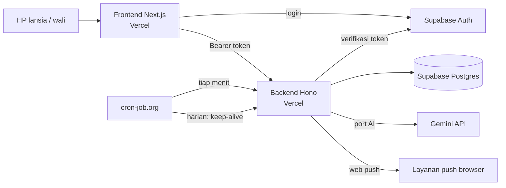
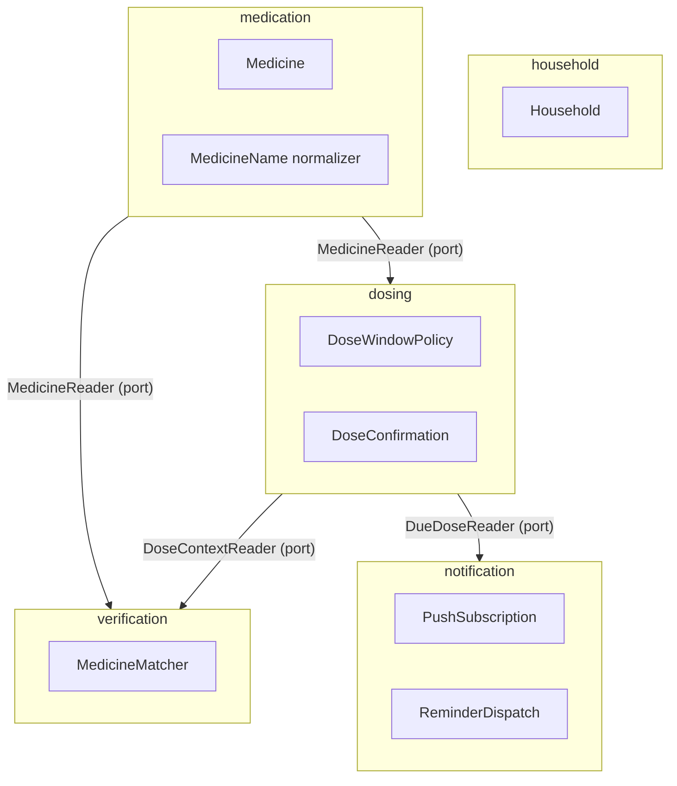
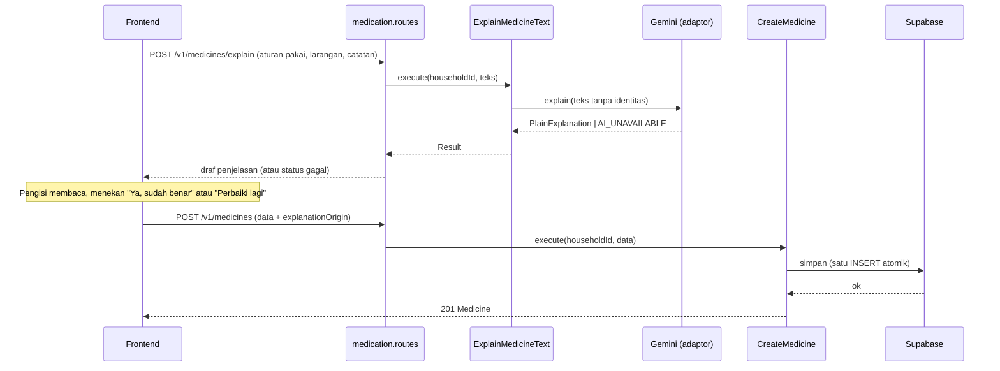
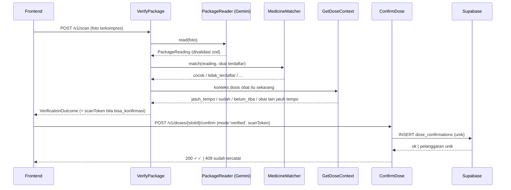
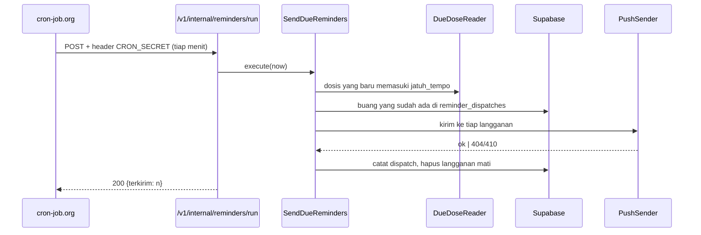
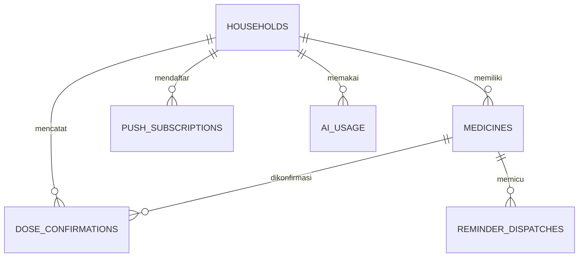

# System Design Backend (DDD) dan Struktur Monorepo: TepatMinum / MOSA

Versi 1.1 · 10 November 2026 · mengikuti arahan mentor: struktur `frontend` + `backend`, frontend berbasis fitur (feature-based), backend berarsitektur DDD, dan AI agent dibekali skill.

Dokumen ini turunan dari PRD v2.0 dan analisis v2.1. Aturan yang berasal dari rekomendasi PM (belum disetujui tim) diberi tanda **[ASUMSI]** dan dikumpulkan di Bagian 16.

---

## 1. Ringkasan keputusan

| Topik | Keputusan | Alasan singkat |
|---|---|---|
| Struktur repo | Satu repo, dua folder utama: `frontend/` dan `backend/` | Sesuai arahan mentor |
| Frontend | Next.js (App Router) dengan pola **feature-based** | Fitur terisolasi, mudah dibagi antar anggota tim |
| Backend | **Hono + TypeScript** dengan arsitektur **DDD berlapis** | Ringan, tervalidasi, deploy nol-konfigurasi di Vercel |
| Database dan login | Supabase (Postgres + Auth), diakses hanya oleh backend | FE tidak menyentuh tabel; satu pintu ke data |
| AI | Gemini lewat **port** (antarmuka) di application layer, adaptor di infrastructure | AI bisa diganti atau dimatikan tanpa mengubah aturan bisnis |
| Hosting | Dua project Vercel dari repo yang sama (root: `frontend`, root: `backend`) | Gratis, satu platform |
| Pemicu pengingat | cron-job.org memanggil endpoint internal backend | Cron Vercel Hobby hanya harian |

**Yang berubah dari saran saya sebelumnya**
1. Backend tidak lagi di dalam Next.js (`app/api`), tetapi aplikasi terpisah. Konsekuensinya: dua kali deploy, satu aturan CORS, dua set environment variable.
2. `packages/core` dihapus. Aturan jendela dosis, pencocokan nama, dan hitungan 1/2 hidup **hanya di domain backend**. Frontend hanya menampilkan hasil yang dikirim backend, jadi tidak ada dua versi hitungan.
3. Zona waktu WIB (UTC+7, tanpa DST) ditangani langsung di domain tanpa library zona waktu.

---

## 2. Struktur monorepo

```
nama-project/
├─ frontend/                 # Next.js, feature-based
├─ backend/                  # Hono, DDD
├─ docs/                     # PRD, dokumen ini, ADR singkat
├─ CLAUDE.md                 # aturan untuk AI agent (lihat Bagian 15)
├─ .claude/skills/           # skill AI agent
├─ package.json              # skrip pembantu di akar (opsional)
├─ pnpm-workspace.yaml
└─ README.md
```

Folder `docs/`, `CLAUDE.md`, dan `.claude/` tidak mengganggu struktur dua folder utama yang diminta mentor.

---

## 3. Gambaran sistem



Prinsip aliran data:
- Browser hanya berbicara dengan Supabase Auth (login) dan backend (semua data).
- Backend memverifikasi token di setiap permintaan lalu menurunkan `householdId` dari sesi, **tidak pernah dari body permintaan**.
- Tabel Supabase dikunci (RLS aktif tanpa kebijakan untuk anon), jadi hanya backend dengan service role yang bisa membaca dan menulis.

---

## 4. Prinsip arsitektur backend

**Model berlapis per modul** (setiap bounded context punya empat lapis):

```
interface  →  application  →  domain
                  ↑
            infrastructure  (mengimplementasikan port milik domain/application)
```

**Aturan dependensi (wajib, dicek otomatis oleh lint):**
1. `domain` tidak mengimpor apa pun dari lapisan lain, library pihak ketiga, maupun `shared/infrastructure`.
2. `application` hanya mengimpor `domain` dan antarmuka (port) yang ia definisikan sendiri.
3. `infrastructure` boleh mengimpor `application` dan `domain` untuk mengimplementasikan port.
4. `interface` (HTTP) memanggil use case, tidak pernah repository atau database langsung.
5. Modul tidak saling mengimpor `domain` atau `infrastructure`. Komunikasi antarmodul lewat port di application layer.

**DDD secukupnya.** Tim punya empat hari, jadi hal berikut sengaja tidak dipakai: event bus, CQRS terpisah, event sourcing, ORM, dan pustaka DI. Yang dipakai: entity, value object, aggregate, domain service, repository (port), use case, dan satu *composition root* untuk merakit dependensi dengan tangan.

**Gaya kode:**
- `strict` TypeScript, tanpa `any`.
- Kegagalan yang diharapkan dikembalikan sebagai `Result<T, E>`, bukan `throw`. `throw` hanya untuk bug.
- zod hanya di dua tempat: validasi permintaan HTTP (interface) dan validasi keluaran AI (adaptor).
- Satu use case = satu kelas atau fungsi dengan satu metode `execute`.
- Waktu selalu lewat port `Clock`, tidak ada `Date.now()` di domain.

---

## 5. Bounded context dan hubungan antarmodul



`householdId` selalu berasal dari sesi pengguna (modul `household`) dan diteruskan ke setiap use case di modul lain.

| Modul | Tanggung jawab | Tahap |
|---|---|---|
| `household` | Menautkan pengguna Supabase ke satu rumah tangga (akun bersama lansia dan wali) | 1 |
| `medication` | Obat, kekuatan, aturan pakai, larangan, catatan, jam minum, label sumber, penjelasan sederhana | 1 |
| `dosing` | Jendela dosis, status belum/sudah/terlewat, konfirmasi minum, tanda ✓ dan ✓✓, hitungan 1/2 | 1 |
| `verification` | Membaca kemasan lewat AI, menormalkan, mencocokkan dengan obat terdaftar, menentukan tindak lanjut | 1 |
| `notification` | Langganan web push, pengiriman pengingat, pencegah kiriman ganda | 2 |

Modul `ai` bukan bounded context. AI adalah detail infrastruktur di balik dua port: `PlainLanguageExplainer` (milik `medication`) dan `PackageReader` (milik `verification`).

---

## 6. Model domain per modul

### 6.1 `household`
- **Household** (aggregate root): `id`, `ownerUserId`, `dataConsentAt | null`, `scanConsentAt | null`, `outputMode: 'teks' | 'suara' | null` (null = belum memilih), `isDemo`. Satu pengguna Supabase punya tepat satu rumah tangga, dibuat otomatis saat login pertama (`EnsureHousehold`).
- Otorisasi: setiap use case menerima `householdId` dari sesi dan hanya menyentuh data milik rumah tangga itu.
- **Persetujuan data (MVP-01):** frontend mewajibkan kotak centang sebelum mendaftar, lalu memanggil `RecordConsent('data')`. Seluruh endpoint selain `/v1/household*` dan `/v1/health` membalas `403 CONSENT_REQUIRED` selama `dataConsentAt` kosong (guard di middleware).
- **Persetujuan scan (PRD 19 #13):** `RecordConsent('scan')` mengisi `scanConsentAt`; frontend juga menyimpan `hasSeenScanConsent` di localStorage per perangkat.
- **Preferensi output (MVP-06):** `UpdatePreferences({ outputMode })`.
- **Hapus data (PRD 19 #14):** `DeleteHouseholdData` menghapus semua data rumah tangga dan pengguna Supabase-nya. Untuk `isDemo = true` dibalas `403 DEMO_PROTECTED`.
- **Use case:** `EnsureHousehold`, `GetHousehold`, `RecordConsent`, `UpdatePreferences`, `DeleteHouseholdData`.

### 6.2 `medication`
- **Medicine** (aggregate root):
  `id`, `householdId`, `name: MedicineName`, `strength: Strength`, `doseAmount: DoseAmount` (misal "1 tablet", "1/2 tablet"), `usageRule: UsageRule`, `warnings`, `notes`, `intakeTimes: TimeOfDay[]`, `labelSource: 'apoteker' | 'keluarga'`, `explanation: PlainExplanation | null`, `explanationOrigin: 'ai_dikonfirmasi' | 'teks_pengisi'`, `active`, `createdAt`.
- **Value object:** `MedicineName` (menyimpan nama asli dan bentuk normal), `Strength` (angka + satuan, kutip "5mg" = "5 mg"), `TimeOfDay` ("HH:mm"), `TimeGroup` (Pagi 04.00–10.59, Siang 11.00–17.59, Malam 18.00–03.59 **[ASUMSI]**).
- **Invarian:** minimal satu jam minum, tanpa jam ganda, nama tidak kosong, kekuatan valid; penjelasan AI hanya boleh tersimpan bila `explanationOrigin = 'ai_dikonfirmasi'` (pengisi menekan "Ya, sudah benar").
- **Domain service:** `MedicineNameNormalizer`: huruf kecil, buang tanda baca dan spasi ganda, buang kata bentuk garam dan sediaan (besilat/besylate, HCl, hidroklorida, natrium/sodium, tablet, kaplet, kapsul), samakan akhiran `-in` dan `-ine`.
- **Port milik application:** `MedicineRepository`, `PlainLanguageExplainer`, `Clock`.
- **Use case:** `ExplainMedicineText` (draf penjelasan, tanpa menyimpan), `CreateMedicine`, `UpdateMedicine`, `DeleteMedicine`, `ListMedicines`, `GetMedicine`.

### 6.3 `dosing`
- **DoseSlot** (value object, dihitung, tidak disimpan): `medicineId`, `scheduledAt` (J), `status`, `confirmation | null`. ID deterministik: `{medicineId}:{yyyymmdd}:{HHmm}`.
- **DoseConfirmation** (entity yang disimpan): `id`, `householdId`, `medicineId`, `scheduledDate`, `scheduledTime`, `confirmedAt`, `level: 'dasar' | 'scan_terverifikasi'` (✓ dan ✓✓). Unik per `(medicineId, scheduledDate, scheduledTime)`.
- **Domain service `DoseWindowPolicy` [ASUMSI]:**
  - `belum_tiba`: sebelum J − 30 menit
  - `jatuh_tempo`: J − 30 menit sampai J + 120 menit
  - `terlewat`: setelah J + 120 menit tanpa konfirmasi
  - Dosis obat yang sama berjarak kurang dari 150 menit: jendela awal berakhir saat jendela berikutnya mulai
  - `sudah`: ada konfirmasi
  - Obat baru yang disimpan setelah J hari itu: slot J tidak dibuat untuk hari itu
- **Invarian `ConfirmDose`:** tidak boleh dikonfirmasi bila `belum_tiba`, `terlewat`, atau `sudah`; level ✓✓ hanya dengan token verifikasi scan yang sah (Bagian 6.4).
- **Hari** berganti pukul 00.00 WIB. Hitungan "1/2" dihitung dari slot hari itu: sudah dikonfirmasi per total slot yang dibuat hari itu.
- **Port:** `DoseConfirmationRepository`, `MedicineScheduleReader` (membaca obat aktif dan jamnya dari modul `medication`), `Clock`.
- **Use case:** `ListTodaysDoses`, `ConfirmDose`, `GetDoseContext` (dipakai `verification`).

Sketsa fungsi murni (belum dijalankan):

```ts
export type DoseStatus = 'belum_tiba' | 'jatuh_tempo' | 'terlewat' | 'sudah';
const MIN = 60_000;

export function classifyDose(p: {
  scheduledAt: number;          // J, epoch ms
  nextScheduledAt?: number;     // J berikutnya obat yang sama
  now: number;
  confirmed: boolean;
}): DoseStatus {
  if (p.confirmed) return 'sudah';
  const opensAt = p.scheduledAt - 30 * MIN;
  let closesAt = p.scheduledAt + 120 * MIN;
  if (p.nextScheduledAt !== undefined && p.nextScheduledAt - p.scheduledAt < 150 * MIN) {
    closesAt = p.nextScheduledAt - 30 * MIN;
  }
  if (p.now < opensAt) return 'belum_tiba';
  if (p.now < closesAt) return 'jatuh_tempo';
  return 'terlewat';
}
```

### 6.4 `verification`
- **PackageReading** (value object dari adaptor AI): `names: string[]`, `strength: string | null`, `legible: boolean`.
- **Domain service `MedicineMatcher`:** menormalkan semua nama terbaca lewat `MedicineNameNormalizer`, lalu membandingkan dengan obat terdaftar. Hasil:
  - `tidak_terbaca` (foto buram atau `legible=false`)
  - `kekuatan_tidak_terbaca` (nama cocok, kekuatan tidak jelas; minta foto ulang)
  - `tidak_terdaftar` (tidak ada nama yang cocok)
  - `kekuatan_beda` (nama cocok, kekuatan berbeda; peringatan)
  - `cocok(medicine)`
- **Use case `VerifyPackage`** (input: gambar, `slotId?` opsional): gambar → `PackageReader` → `MedicineMatcher` → `GetDoseContext` → `VerificationOutcome` berupa union terdiskriminasi. Perutean ganda (PRD 19 #10): bila `slotId` diberikan (dari kartu dosis atau banner, rute `/scan?dosis=...`) mode verifikasi memakai slot itu; bila tidak ada, kode mencari dosis yang sedang jatuh tempo untuk obat yang terbaca. Setiap hasil membawa data terstruktur (nama, kekuatan, jam, `nextDose`, penjelasan terverifikasi, label sumber), **bukan kalimat jadi**; frontend merakit kalimat baku dari `copy.ts`. Daftar hasil:
  - `bisa_konfirmasi` (ada dosis jatuh tempo untuk obat itu; menyertakan `slotId` dan **scanToken**)
  - `dosis_sudah_tercatat`
  - `belum_waktunya` / `waktunya_lain`
  - `tunggu_dulu` (ada obat lain jatuh tempo; daftar dipisah "dan")
  - `hanya_info` (obat terdaftar, bukan waktunya)
  - `tidak_terdaftar`, `tidak_terbaca`, `kekuatan_tidak_terbaca`, `kekuatan_beda`
- **scanToken:** token bertanda tangan HMAC berisi `{householdId, medicineId, slotId, exp}` dengan masa berlaku singkat (sekitar 5 menit). `ConfirmDose` dengan `mode: 'verified'` memeriksa token itu. Klien tidak bisa mengklaim ✓✓ tanpa hasil scan yang sah.
- **Port:** `PackageReader`, `MedicineReader`, `DoseContextReader`, `ScanTokenSigner`.

### 6.5 `notification` (Tahap 2)
- **PushSubscription** (aggregate): `id`, `householdId`, `endpoint` (unik), `p256dh`, `auth`.
- **ReminderDispatch:** `(medicineId, scheduledDate, scheduledTime, kind)` unik. Mencegah pengingat ganda saat cron diulang.
- **Use case `SendDueReminders`:** ambil dosis yang baru memasuki `jatuh_tempo` lewat `DueDoseReader`, lewati yang sudah ada di `reminder_dispatches`, kirim lewat port `PushSender`, catat dispatch. Respons 404 atau 410 dari layanan push berarti langganan mati dan harus dihapus.
- **Use case:** `SubscribePush`, `UnsubscribePush`, `SendDueReminders`.

---

## 7. Struktur folder backend

```
backend/
├─ src/
│  ├─ index.ts                      # export default app (entri Vercel/Hono)
│  ├─ app.ts                        # membuat Hono app, memasang middleware + rute
│  ├─ composition-root.ts           # merakit repository, adaptor, use case
│  ├─ config/
│  │  └─ env.ts                     # validasi environment variable dengan zod
│  ├─ shared/
│  │  ├─ domain/                    # Result, DomainError, Clock, Id, WibTime
│  │  ├─ application/               # tipe use case, UnitOfWork bila perlu
│  │  └─ infrastructure/            # supabase client, logger, system clock
│  └─ modules/
│     ├─ household/
│     │  ├─ domain/                 # household.ts, household-repository.ts
│     │  ├─ application/            # ensure-household.use-case.ts
│     │  ├─ infrastructure/         # supabase-household.repository.ts
│     │  └─ interface/              # (middleware auth memakai modul ini)
│     ├─ medication/
│     │  ├─ domain/
│     │  │  ├─ medicine.ts
│     │  │  ├─ value-objects/       # medicine-name.ts, strength.ts, time-of-day.ts, time-group.ts
│     │  │  ├─ services/            # medicine-name-normalizer.ts
│     │  │  ├─ medicine-repository.ts       # port
│     │  │  └─ errors.ts
│     │  ├─ application/
│     │  │  ├─ ports/               # plain-language-explainer.ts
│     │  │  ├─ create-medicine.use-case.ts
│     │  │  ├─ explain-medicine-text.use-case.ts
│     │  │  ├─ list-medicines.use-case.ts
│     │  │  └─ ...
│     │  ├─ infrastructure/
│     │  │  ├─ supabase-medicine.repository.ts
│     │  │  └─ gemini-plain-language-explainer.ts
│     │  └─ interface/
│     │     ├─ medication.routes.ts
│     │     ├─ medication.schemas.ts        # zod permintaan/respons
│     │     └─ medication.mapper.ts
│     ├─ dosing/
│     │  ├─ domain/                 # dose-slot.ts, dose-confirmation.ts, services/dose-window-policy.ts
│     │  ├─ application/            # list-todays-doses, confirm-dose, get-dose-context, ports/
│     │  ├─ infrastructure/         # supabase-dose-confirmation.repository.ts, medicine-schedule-reader.ts
│     │  └─ interface/              # dosing.routes.ts, dosing.schemas.ts
│     ├─ verification/
│     │  ├─ domain/                 # package-reading.ts, services/medicine-matcher.ts
│     │  ├─ application/            # verify-package.use-case.ts, ports/
│     │  ├─ infrastructure/         # gemini-package-reader.ts, hmac-scan-token-signer.ts
│     │  └─ interface/              # verification.routes.ts
│     └─ notification/              # Tahap 2, struktur sama
├─ supabase/
│  ├─ migrations/                   # SQL berurutan
│  └─ seed.sql                      # akun Demo Juri + contoh obat fiktif
├─ tests/
│  ├─ unit/                         # domain
│  ├─ application/                  # use case dengan repository palsu (in-memory)
│  └─ e2e/                          # satu alur utama
├─ eslint.config.js                 # termasuk aturan batas lapisan
├─ tsconfig.json
├─ vitest.config.ts
└─ package.json
```

**Penegakan batas lapisan:** pakai `eslint-plugin-boundaries` atau `dependency-cruiser` dengan aturan dari Bagian 4. Aturan ini dijalankan di CI dan sebelum commit.

---

## 8. Alur utama

### 8.1 Tambah Obat dengan penjelasan AI



Bila AI gagal, FE tetap bisa menyimpan dengan `explanationOrigin = 'teks_pengisi'`. Tidak ada teks AI yang belum diperiksa manusia yang sampai ke lansia.

### 8.2 Scan kemasan lalu konfirmasi minum



AI hanya mengembalikan nama dan kekuatan. Pencocokan, jendela waktu, dan keputusan boleh-tidaknya konfirmasi dihitung kode.

### 8.3 Pengingat terjadwal (Tahap 2)



---

## 9. Desain API

Prefiks `/v1`. Autentikasi: `Authorization: Bearer <access token Supabase>` kecuali endpoint `internal` dan `health`.

| Metode dan path | Fungsi | Use case |
|---|---|---|
| `POST /v1/medicines/explain` | Draf penjelasan sederhana (tidak menyimpan) | ExplainMedicineText |
| `POST /v1/medicines` | Simpan obat | CreateMedicine |
| `GET /v1/medicines` | Daftar obat aktif | ListMedicines |
| `GET /v1/medicines/{id}` | Detail obat | GetMedicine |
| `PATCH /v1/medicines/{id}` | Ubah obat | UpdateMedicine |
| `DELETE /v1/medicines/{id}` | Hapus (soft delete) | DeleteMedicine |
| `GET /v1/doses/today` | Kartu dosis hari ini + hitungan 1/2 | ListTodaysDoses |
| `POST /v1/doses/{slotId}/confirm` | Konfirmasi minum | ConfirmDose |
| `POST /v1/scan` | Baca kemasan dan tentukan tindak lanjut (body: foto, `slotId?`) | VerifyPackage |
| `GET /v1/household` | Status persetujuan dan preferensi output (membuat rumah tangga bila belum ada) | EnsureHousehold, GetHousehold |
| `POST /v1/household/consents` | Catat persetujuan `data` atau `scan` | RecordConsent |
| `PATCH /v1/household/preferences` | Ubah mode output Teks/Suara | UpdatePreferences |
| `DELETE /v1/household` | Hapus semua data dan akun (ditolak untuk akun demo) | DeleteHouseholdData |
| `POST /v1/push/subscriptions` | Daftar web push (Tahap 2) | SubscribePush |
| `DELETE /v1/push/subscriptions` | Batal langganan | UnsubscribePush |
| `POST /v1/internal/reminders/run` | Dipanggil cron (header `x-cron-secret`) | SendDueReminders |
| `GET /v1/health` | Cek hidup dan baca ringan ke database (keep-alive) | – |

**Format kesalahan seragam:**

```json
{ "error": { "code": "DOSE_NOT_DUE", "message": "Dosis belum waktunya.", "details": null } }
```

| Kode | HTTP | Sebab |
|---|---|---|
| `VALIDATION_FAILED` | 400 | Body tidak lolos zod |
| `UNAUTHENTICATED` | 401 | Token tidak ada atau tidak valid |
| `CONSENT_REQUIRED` | 403 | Persetujuan data belum dicatat |
| `DEMO_PROTECTED` | 403 | Akun demo juri tidak boleh dihapus |
| `NOT_FOUND` | 404 | Obat atau dosis bukan milik rumah tangga ini |
| `DOSE_NOT_DUE` | 409 | Status `belum_tiba` |
| `DOSE_MISSED` | 409 | Status `terlewat` |
| `DOSE_ALREADY_CONFIRMED` | 409 | Sudah ada konfirmasi |
| `SCAN_TOKEN_INVALID` | 403 | Token scan salah atau kedaluwarsa |
| `PHOTO_UNREADABLE` | 422 | Foto tidak terbaca |
| `AI_QUOTA_EXCEEDED` | 429 | Jatah AI harian habis atau 429 dari Gemini |
| `AI_UNAVAILABLE` | 503 | Gemini gagal atau melewati batas waktu |

Pemetaan galat domain ke HTTP dilakukan di satu tempat (`error-handler` di interface), bukan di setiap rute.

---

## 10. Model data



```sql
-- sketsa; bentuk akhir ditulis sebagai migrasi di backend/supabase/migrations
create table households (
  id uuid primary key default gen_random_uuid(),
  owner_user_id uuid not null unique,        -- auth.users.id
  data_consent_at timestamptz,               -- persetujuan penyimpanan data (MVP-01)
  scan_consent_at timestamptz,               -- persetujuan sebelum scan pertama
  output_mode text check (output_mode in ('teks','suara')),  -- null = belum memilih
  is_demo boolean not null default false,    -- akun demo juri: tidak bisa dihapus
  created_at timestamptz not null default now()
);

create table medicines (
  id uuid primary key default gen_random_uuid(),
  household_id uuid not null references households(id),
  name text not null,
  name_normalized text not null,
  strength text not null,
  strength_normalized text not null,
  dose_amount text not null,
  usage_rule text not null,
  warnings text,
  notes text,
  intake_times text[] not null,              -- ['07:00','19:00'], disimpan WIB
  label_source text not null check (label_source in ('apoteker','keluarga')),
  explanation text,
  explanation_origin text not null check (explanation_origin in ('ai_dikonfirmasi','teks_pengisi')),
  active boolean not null default true,
  created_at timestamptz not null default now()
);
create index on medicines (household_id) where active;

create table dose_confirmations (
  id uuid primary key default gen_random_uuid(),
  household_id uuid not null references households(id),
  medicine_id uuid not null references medicines(id),
  scheduled_date date not null,              -- tanggal WIB
  scheduled_time time not null,              -- jam WIB
  confirmed_at timestamptz not null,
  level text not null check (level in ('dasar','scan_terverifikasi')),
  unique (medicine_id, scheduled_date, scheduled_time)
);

create table push_subscriptions (
  id uuid primary key default gen_random_uuid(),
  household_id uuid not null references households(id),
  endpoint text not null unique,
  p256dh text not null,
  auth text not null
);

create table reminder_dispatches (
  medicine_id uuid not null references medicines(id),
  scheduled_date date not null,
  scheduled_time time not null,
  kind text not null,
  sent_at timestamptz not null default now(),
  primary key (medicine_id, scheduled_date, scheduled_time, kind)
);

create table ai_usage (
  household_id uuid not null references households(id),
  day date not null,
  count int not null default 0,
  primary key (household_id, day)
);

alter table households enable row level security;   -- tanpa kebijakan untuk anon:
alter table medicines enable row level security;    -- hanya service role (backend) yang bisa akses
alter table dose_confirmations enable row level security;
alter table push_subscriptions enable row level security;
alter table reminder_dispatches enable row level security;
alter table ai_usage enable row level security;
```

Catatan desain:
- Status `belum_tiba`, `jatuh_tempo`, dan `terlewat` **tidak disimpan**. Dihitung dari jam jadwal, waktu sekarang, dan ada tidaknya baris di `dose_confirmations`. Tidak perlu tugas harian yang membuat baris dosis.
- Batasan unik pada `dose_confirmations` adalah pagar terakhir terhadap minum ganda, sehingga konfirmasi ganda dari dua perangkat bertabrakan di database dan dibalas 409.
- Akses lewat `supabase-js` (REST), jadi tidak ada masalah kumpulan koneksi di serverless. Penyimpanan satu obat adalah satu `INSERT` karena jam minum berupa kolom larik, sehingga atomik tanpa transaksi.
- Foto kemasan tidak disimpan.

---

## 11. Keamanan, keandalan, dan privasi

| Aspek | Rancangan |
|---|---|
| Autentikasi | Verifikasi token Supabase di middleware (`auth.getUser(token)` untuk MVP; verifikasi lokal bila perlu lebih cepat) |
| Otorisasi | `householdId` hanya dari sesi. Setiap query repository menyertakan `household_id`. Akses obat milik rumah tangga lain dibalas 404 |
| Validasi | zod di interface; batas panjang teks; foto maksimum sekitar 1,5 MB, hanya JPEG/PNG/WebP |
| AI: input | Instruksi tetap di `systemInstruction`, data pengguna terpisah; tidak mengirim nama pasien, umur, email, atau data akun |
| AI: output | Divalidasi zod; hasil rusak diperlakukan sebagai gagal |
| AI: batas | Batas waktu 15–20 detik; batas jatah harian per rumah tangga (`ai_usage`); dekorator `RateLimited...` membungkus adaptor |
| AI: gagal | Selalu ada jalur cadangan: simpan teks pengisi tanpa penjelasan AI; scan gagal berarti tidak ada konfirmasi |
| CORS | Hanya origin frontend (`FRONTEND_ORIGIN`) |
| Rahasia | Hanya di environment variable server; `server-only`; tidak pernah di FE |
| Cron | Header `x-cron-secret` dibandingkan dengan perbandingan waktu-konstan |
| Log | JSON terstruktur; hanya kode, status, dan durasi; **tidak** mencatat isi teks, foto, atau data obat |
| Keep-alive | cron-job.org memanggil `/v1/health` harian agar proyek Supabase gratis tidak dipause |
| Cadangan | Paket gratis tanpa backup otomatis; simpan `seed.sql` dan migrasi di repo |
| Data Gemini gratis | Isian dikirim ke tier gratis yang dapat dipakai Google untuk perbaikan produk; pengujian dan demo memakai data fiktif |

---

## 12. Strategi pengujian

| Lapis | Alat | Yang diuji |
|---|---|---|
| Domain | Vitest, tanpa mock | `classifyDose` (batas J−30, J+120, tumpang tindih <150 menit, lewat tengah malam WIB), normalizer nama, `MedicineMatcher`, invarian `Medicine` |
| Application | Vitest + repository dan port palsu (in-memory), `Clock` tetap | `ConfirmDose` (belum tiba, terlewat, ganda, token salah), `VerifyPackage` (semua hasil), `CreateMedicine` |
| Infrastructure | Vitest + fixture rekaman respons Gemini | Parser keluaran AI, penanganan 429 dan batas waktu |
| E2E | Satu skenario | Login demo → tambah obat → scan → konfirmasi ✓✓ |

Daftar kasus wajib (turunan AC-17 sampai AC-26 pada analisis v2.1):
1. Scan obat terdaftar di luar jendela dosis → hasil `hanya_info`, tanpa tombol konfirmasi.
2. Dua obat berjam sama → scan satu hanya mengonfirmasi obat itu.
3. Scan obat yang dosisnya sudah tercatat → `dosis_sudah_tercatat`, tanpa tombol.
4. Obat disimpan pukul 15.00 dengan jadwal 07.00 dan 19.00 → hari itu 0/1.
5. "Amlodipine besylate" di kemasan cocok dengan obat terdaftar "Amlodipin".
6. Kekuatan 5 mg versus 10 mg → `kekuatan_beda`.
7. Dua permintaan konfirmasi bersamaan → satu berhasil, satu 409.
8. Pukul 23.50 WIB dan 00.10 WIB jatuh pada hari yang berbeda.
9. Gemini gagal saat scan → tidak ada konfirmasi; gagal saat penjelasan → simpan tetap bisa.

---

## 13. Struktur frontend (feature-based)

```
frontend/
├─ src/
│  ├─ app/                          # hanya routing + komposisi halaman (tipis)
│  │  ├─ (auth)/login/page.tsx
│  │  ├─ (app)/page.tsx             # dashboard hari ini
│  │  ├─ (app)/medicines/new/page.tsx
│  │  ├─ (app)/medicines/[id]/page.tsx
│  │  ├─ (app)/scan/page.tsx
│  │  └─ layout.tsx
│  ├─ features/
│  │  ├─ auth/                      # login, sesi Supabase, guard
│  │  ├─ medicines/                 # form Tambah Obat, pop-up konfirmasi penjelasan, daftar
│  │  ├─ doses/                     # kartu dosis, tombol konfirmasi, ringkasan 1/2
│  │  ├─ scan/                      # ambil foto, kompres, hasil verifikasi
│  │  └─ reminders/                 # banner pengingat, suara (speechSynthesis), push (Tahap 2)
│  ├─ shared/
│  │  ├─ ui/                        # komponen dasar (shadcn/ui), tombol besar, dialog
│  │  ├─ lib/                       # api-client (fetch + token), format tanggal WIB, supabase client
│  │  ├─ hooks/
│  │  └─ config/
│  └─ styles/
├─ public/                          # manifest.webmanifest, sw.js (Tahap 2)
└─ package.json
```

**Isi tiap fitur** (contoh `features/doses/`):

```
features/doses/
├─ components/        # DoseCard, ConfirmButton, DaySummary
├─ hooks/             # useTodaysDoses, useConfirmDose
├─ api/               # fungsi pemanggil backend + kunci query
├─ schemas/           # zod bentuk respons backend
├─ types.ts
└─ index.ts           # satu-satunya pintu keluar fitur
```

**Aturan impor (dicek lint):**
1. Fitur hanya mengimpor fitur lain lewat `index.ts` miliknya, tidak ke dalam folder.
2. `shared/` tidak boleh mengimpor dari `features/`.
3. `app/` hanya merangkai komponen fitur; tidak berisi logika bisnis.
4. Frontend **tidak menghitung** status dosis. Ia menampilkan `status` yang dikirim backend.
5. Satu pemanggil API (`shared/lib/api-client`) menambahkan token dan memetakan format kesalahan.

---

## 14. Rencana kerja sampai tenggat

Hari ini Selasa 10 November. Titik penting: **Kamis 12 November siang** (keputusan lanjut ke web push atau tidak, sesuai PRD) dan **Sabtu 14 November 23.59 WIB** (code freeze).

| Waktu | Backend | Frontend |
|---|---|---|
| Selasa malam | Scaffold `backend/`, `env.ts`, lint batas lapisan, migrasi tabel, `shared/domain` | Scaffold `frontend/`, login Supabase, `api-client` |
| Rabu | `household` + `medication` (domain, use case, repository, rute), pengujian domain | Fitur `medicines`: form, pop-up konfirmasi, daftar |
| Kamis pagi | `dosing`: `classifyDose`, `ListTodaysDoses`, `ConfirmDose` + tes | Fitur `doses`: dashboard, kartu, konfirmasi |
| Kamis siang | **Titik keputusan Tahap 2.** `verification` bila lolos | Fitur `scan`: kamera, kompres, hasil |
| Jumat | `verification` selesai; `notification` bila Tahap 2 jalan | Suara, banner, PWA/push bila Tahap 2 |
| Sabtu | Uji di HP nyata, perbaikan, README, akun Demo Juri, keep-alive, **freeze 23.59** | Sama |

Peringatan jujur: memisahkan backend dan menerapkan DDD menambah beban awal sekitar setengah hari dibanding Next.js saja. Untuk menjaga tenggat: kerjakan **irisan vertikal** (satu fitur dari rute sampai database, lalu fitur berikutnya), pertahankan DDD secukupnya (Bagian 4), dan tunda `notification` bila Kamis siang belum ada alur inti yang stabil.

---

## 15. Skill dan aturan untuk AI agent

Bagian ini mengasumsikan "AI agent" yang dimaksud mentor adalah agen penulis kode (misalnya Claude Code) yang dibekali aturan dan skill agar kodenya konsisten dan mengikuti praktik terbaik. Bila yang dimaksud adalah AI di dalam produk (Gemini), lihat Bagian 6.2, 6.4, dan 11.

Kit yang disertakan (berkas terpisah, salin ke akar repo):

```
nama-project/
├─ CLAUDE.md                              # ringkasan proyek, perintah, aturan arsitektur, definisi selesai
└─ .claude/skills/
   ├─ backend-ddd/SKILL.md                # lapisan, aturan dependensi, cara menambah use case
   ├─ frontend-feature-based/SKILL.md     # struktur fitur, aturan impor, aksesibilitas lansia
   ├─ medication-domain-rules/SKILL.md    # aturan keselamatan: AI tidak memutuskan, jendela dosis, ✓/✓✓
   └─ testing-and-quality/SKILL.md        # pola uji, perintah, definisi selesai, gaya commit
```

---

## 16. Asumsi dan keputusan terbuka untuk tim

| No | Hal | Status |
|---|---|---|
| 1 | Jendela dosis (−30/+120 menit, tumpang tindih <150 menit) | **[ASUMSI]** perlu persetujuan tim |
| 2 | Batas kelompok waktu Pagi/Siang/Malam | **[ASUMSI]** |
| 3 | Aturan obat disimpan di tengah hari (slot yang sudah lewat tidak dibuat) | **[ASUMSI]** |
| 4 | Backend di Vercel (Hono) vs layanan lain | Disarankan Vercel; layanan gratis lain yang tidur saat tidak aktif tidak cocok untuk demo dan cron |
| 5 | Token scan HMAC berumur ±5 menit | Usulan teknis |
| 6 | Nama model Gemini dan batas harian per rumah tangga | Tentukan setelah uji kuota di AI Studio |
| 7 | Nama produk (TepatMinum, MOSA, atau lainnya) | Terbuka; folder repo memakai `nama-project` sementara |

---

## Sumber

- [Hono on Vercel](https://vercel.com/docs/frameworks/backend/hono): deploy Hono ke Vercel tanpa konfigurasi.
- [Cara deploy Hono di Vercel](https://vercel.com/kb/guide/ship-a-hono-app-on-vercel): lokasi entri dan perilaku fungsi.
- [Template Turborepo + Hono](https://vercel.com/kb/guide/build-with-a-hono-starter-template): contoh monorepo backend Hono dan frontend Next.js.
- [Render, perilaku layanan gratis](https://render.com/changelog/free-web-services-now-remain-active-while-receiving-websocket-messages): layanan gratis tidur setelah 15 menit tanpa lalu lintas.
- [Batas Hobby dan cron Vercel](https://vercel.com/docs/plans/hobby): pemakaian non-komersial; cron Hobby hanya harian.
- [FAQ cron-job.org](https://cron-job.org/faq/): layanan gratis, mendukung HTTPS dan POST.
- Dokumen yang diperiksa: PRD_MOSA_LOGICODIX_2026.pdf, Ide-Produk-Final-LOGICODIX.docx, dan analisis PRD v2.1.
